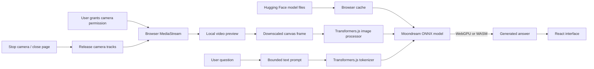

# Real-Time On-Device Vision-Language Assistant

A browser-based React and TypeScript camera assistant. It captures a small frame locally and runs the `Xenova/moondream2` vision-language model with Transformers.js using WebGPU when available and the WebAssembly runtime otherwise. The app has no inference backend and contains no image upload code.

Model weights and tokenizer assets are downloaded from Hugging Face on first use and cached by the browser. Camera images stay in browser memory and are not sent to the model host or an application server. “Live scan” samples a frame every 2.5 seconds when inference is not already running; timing depends on the device.

## Architecture and workflow



## Run locally

Use Node.js 20 or newer and a current browser that supports `getUserMedia`. Camera access requires localhost or HTTPS. Install dependencies and start Vite:

```sh
npm install
npm run dev
```

Open the local URL, choose **Load local model**, then **Enable camera** and ask a question. The first model load may take time and needs network access to retrieve model assets. Camera permission is requested only after you choose **Enable camera**.

For a production bundle:

```sh
npm run build
npm run preview
```

## Privacy and runtime limits

- Video frames are downscaled to a maximum 384-pixel edge before inference.
- Prompt text is limited to 500 characters and generation is limited to 96 new tokens.
- Inference is local after model assets load. The browser requests model assets from Hugging Face on first load; the deployment does not bundle model weights.
- Browser GPU support and device memory vary. WebAssembly fallback may be slow; the model may fail on constrained devices.
- The live mode is periodic still-frame analysis rather than continuous video-token streaming.
- Stop camera turns off live mode and releases all media tracks.

See [architecture and privacy](docs/ARCHITECTURE.md) and [development and deployment](docs/DEVELOPMENT.md).
